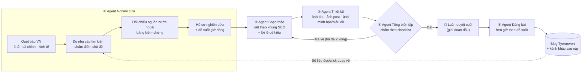
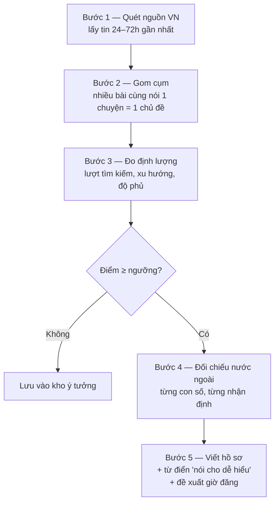

# Phòng biên tập AI — Bản nháp v1

> Trạng thái: **first draft để thảo luận**, chưa viết code.
> Phạm vi: blog Tyertrovert (repo này, Astro + Cloudflare) là kênh đăng đầu tiên. Các kênh khác bổ sung sau.
> Những chỗ đánh dấu **[CẦN CHỐT]** là chỗ cần Luân trả lời trước khi làm bản v2.

---

## 1. Bức tranh tổng thể



**Nguyên tắc vận hành:**

1. **Mỗi bài = một "hồ sơ bài"** (một thư mục). Agent nào làm xong thì ghi kết quả vào hồ sơ, agent sau chỉ đọc hồ sơ — không truyền miệng giữa các agent. Nhờ vậy truy vết được: câu nào trong bài lấy từ nguồn nào.
2. **Có cửa chặn ở mỗi bước.** Thiếu dữ liệu bắt buộc thì dừng, không cố "đoán cho đủ".
3. **Giai đoạn đầu luôn có người duyệt cuối** (Luân). Khi 10–20 bài liên tiếp không cần sửa gì đáng kể, mới cân nhắc để Tổng biên tập tự duyệt.
4. **Vòng phản hồi:** số liệu thật sau khi đăng (lượt xem, từ khóa Google) quay về giúp Agent Nghiên cứu chọn chủ đề tốt hơn.

---

## 2. Hồ sơ bài — cấu trúc dữ liệu dùng chung

```
phong-bien-tap/ho-so/2026-11-12-gia-xang-giam-thang-11/
├── 01-nghien-cuu.json      ← Agent Nghiên cứu
├── 02-ban-thao.md          ← Agent Soạn thảo (đúng format bài blog hiện tại)
├── 03-thiet-ke/            ← Agent Thiết kế
│   ├── anh-bia-1200x630.png
│   ├── post-1080x1350.png
│   └── minh-hoa-01.svg
├── 04-duyet.json           ← Agent Tổng biên tập (+ ghi chú của Luân)
└── 05-dang-bai.json        ← Agent Đăng bài (đã đăng ở đâu, lúc nào, link)
```

Trạng thái bài đi theo thứ tự: `de-xuat → dang-viet → dang-thiet-ke → cho-duyet → tra-ve → da-duyet → da-hen-gio → da-dang`.

---

## 3. Agent Nghiên cứu (phần quan trọng nhất)

### 3.1 Quy trình 5 bước



### 3.2 Danh sách nguồn (nháp — **[CẦN CHỐT]** thêm/bớt)

| Nhóm | Nguồn Việt Nam | Nguồn nước ngoài để đối chiếu |
|---|---|---|
| Kinh tế vĩ mô | VnExpress Kinh doanh, VnEconomy, Tuổi Trẻ, Thanh Niên | Reuters, Bloomberg, Nikkei Asia, World Bank, IMF, ADB |
| Tài chính – ngân hàng – chứng khoán | CafeF, VietnamBiz, Vietstock, Người Lao Động | Reuters, Fitch / Moody's / S&P (xếp hạng tín nhiệm), FTSE Russell, MSCI |
| Ô tô | VnExpress Xe, Znews Xe, Autopro, VAMA (số liệu bán hàng) | Reuters Autos, Nikkei Asia, Bloomberg, báo cáo của chính hãng (IR) |
| Số liệu gốc | Tổng cục Thống kê (GSO), Ngân hàng Nhà nước | Trading Economics, CEIC, dữ liệu IMF/WB |

**Bộ lọc chính trị:** loại tin có từ khóa về nhân sự lãnh đạo, đảng, bầu cử, tranh chấp lãnh thổ, kỷ luật cán bộ… Nếu một tin kinh tế dính chính sách (ví dụ: luật thuế mới), chỉ viết về **tác động tới túi tiền người đọc**, không bình luận chủ trương.

### 3.3 Chấm điểm chủ đề bằng định lượng

Mỗi chủ đề được chấm trên thang 100:

| Tiêu chí | Trọng số | Đo bằng gì |
|---|---:|---|
| Nhu cầu tìm kiếm (lượng) | 30 | Google Trends (khu vực VN), công cụ từ khóa **[CẦN CHỐT]** |
| Đà tăng (đang "nóng" lên hay nguội đi) | 20 | So 7 ngày gần nhất với 30 ngày trước trên Google Trends |
| Độ phủ báo VN | 15 | Số bài/số báo cùng đưa tin trong 72h |
| Kiểm chứng được bằng nguồn nước ngoài | 20 | Có ≥ 1 nguồn nước ngoài uy tín nói cùng chuyện không |
| Hợp với blog & người đọc | 15 | Khớp chuyên mục, có thể nói "chuyện này ảnh hưởng gì đến bạn" |
| **Trừ điểm** | –∞ / –20 | Dính chính trị → loại hẳn. Cạnh tranh từ khóa quá cao → trừ |

Ngưỡng nháp: **≥ 60 điểm** mới đưa vào viết. Mỗi tuần chọn tối đa N bài có điểm cao nhất **[CẦN CHỐT N]**.

> Lưu ý thực tế: Google Trends chỉ cho **chỉ số tương đối (0–100)**, không cho số lượt tìm tuyệt đối. Muốn có số tuyệt đối cần Google Keyword Planner (cần tài khoản Google Ads) hoặc công cụ trả phí (Ahrefs, Semrush…). Sau khi blog có Google Search Console, dữ liệu từ khóa của chính blog sẽ là nguồn tốt nhất.

### 3.4 Đối chiếu nguồn nước ngoài — "bảng kiểm chứng"

Agent tách bài báo VN thành **từng nhận định/con số**, rồi tìm nguồn nước ngoài cho từng cái:

| Kết quả | Ý nghĩa | Xử lý khi viết |
|---|---|---|
| ✅ Khớp | VN và nước ngoài nói giống nhau | Viết bình thường, ghi cả 2 nguồn |
| ⚠️ Lệch | Cùng chuyện nhưng con số/cách hiểu khác | Nêu cả 2 con số, giải thích vì sao có thể khác |
| 🔶 Chỉ có nguồn VN | Không tìm được nguồn nước ngoài | Ghi rõ "theo báo X", không khẳng định chắc chắn |
| ❌ Mâu thuẫn | Nguồn nước ngoài nói ngược lại | Không dùng làm ý chính; nếu dùng phải nêu rõ hai bên |

**Bẫy cần tránh:** rất nhiều báo nước ngoài cũng **trích lại số liệu của Tổng cục Thống kê hoặc Ngân hàng Nhà nước**. Lúc đó hai nguồn "khớp" nhưng thực chất là một nguồn. Vì vậy mỗi nhận định phải ghi thêm **nguồn gốc dữ liệu** (ai là người đầu tiên công bố). Nếu có thể, ưu tiên nguồn độc lập (ví dụ: chỉ số PMI của S&P Global, dữ liệu xuất nhập khẩu của nước đối tác, báo cáo của tổ chức xếp hạng).

### 3.5 Đầu ra: `01-nghien-cuu.json` (mẫu)

```json
{
  "chu_de": "Giá xăng giảm 3 kỳ liên tiếp",
  "chuyen_muc": "kinh-te",
  "diem": { "tong": 74, "tim_kiem": 24, "da_tang": 16, "do_phu": 12, "kiem_chung": 14, "phu_hop": 8 },
  "tu_khoa": { "chinh": "giá xăng hôm nay", "phu": ["giá xăng giảm", "giá dầu thế giới"] },
  "nguon_vn": [{ "bao": "VnExpress", "tieu_de": "...", "url": "...", "ngay": "2026-11-11" }],
  "nguon_nuoc_ngoai": [{ "bao": "Reuters", "tieu_de": "...", "url": "...", "ngay": "2026-11-10" }],
  "bang_kiem_chung": [
    {
      "nhan_dinh": "Giá dầu Brent giảm 8% trong tháng 10",
      "nguon_vn": "VnExpress",
      "nguon_nuoc_ngoai": "Reuters",
      "nguon_goc_du_lieu": "ICE Futures",
      "ket_qua": "khop",
      "ghi_chu": ""
    }
  ],
  "tu_dien_de_hieu": [
    { "tu_kho": "quỹ bình ổn giá xăng dầu", "noi_de_hieu": "khoản tiền nhà nước để dành, dùng để kéo giá xăng xuống khi giá thế giới tăng quá mạnh" }
  ],
  "goc_nhin_nguoi_doc": "Mỗi lần đổ đầy bình xe máy rẻ hơn khoảng X nghìn đồng",
  "de_xuat_gio_dang": { "thoi_diem": "2026-11-13T07:30:00+07:00", "ly_do": "..." }
}
```

### 3.6 Đề xuất giờ đăng

- **Giai đoạn chưa có số liệu:** dùng giờ phổ biến cho người đọc VN (sáng 6:30–8:00 trên đường đi làm, trưa 11:30–13:00, tối 20:00–22:00) + **đăng sớm khi tin còn nóng** (tin nóng càng để lâu càng mất giá trị).
- **Khi đã có số liệu** (Cloudflare Analytics, Search Console, insight của mạng xã hội): chuyển sang giờ có lượt đọc thực tế cao nhất của chính blog.
- Blog hiện đã hỗ trợ hẹn giờ: đặt `pubDate` ở tương lai, GitHub Actions build lại mỗi giờ (sai số ≤ 1 giờ).

---

## 4. Agent Soạn thảo

- **Đầu vào:** `01-nghien-cuu.json`. Chỉ được dùng thông tin có trong hồ sơ — không tự thêm số liệu "từ trí nhớ".
- **Đầu ra:** `02-ban-thao.md` đúng format blog hiện tại (frontmatter `title`, `description`, `pubDate`, `category`, `draft`).
- **Khung SEO:** **[CẦN CHỐT — Luân nói sẽ gửi sau]**. Tạm thời giữ chỗ: tiêu đề có từ khóa chính, đoạn mở trả lời ngay câu hỏi người đọc, các mục H2/H3, phần "Điều này ảnh hưởng gì đến bạn?", nguồn tham khảo cuối bài.
- **Quy tắc "ai đọc cũng hiểu":**
  - Câu ≤ 25 chữ; mỗi đoạn ≤ 4 câu.
  - Mỗi thuật ngữ lần đầu xuất hiện phải giải thích bằng lời thường (lấy từ `tu_dien_de_hieu`).
  - Đổi con số lớn về đơn vị đời thường: "18.000 tỷ đồng" → "khoảng 180.000 đồng cho mỗi người dân".
  - Hạn chế từ Hán-Việt nặng và tiếng Anh không cần thiết; bắt buộc dùng thì giải thích trong ngoặc.
  - Tách rõ **sự thật** (có nguồn) và **nhận định** (của blog).
- **Ghi nguồn:** mỗi con số có link nguồn; cuối bài có mục "Nguồn tham khảo" chia 2 nhóm: báo Việt Nam / báo nước ngoài.
- **Bản quyền:** tổng hợp và viết lại bằng lời của mình, không chép nguyên đoạn; trích dẫn ngắn có ghi nguồn.

---

## 5. Agent Thiết kế

| Loại ảnh | Kích thước | Dùng cho |
|---|---|---|
| Ảnh bìa / ảnh chia sẻ | 1200 × 630 | Đầu bài blog, ảnh hiện khi chia sẻ link (Facebook, Zalo) |
| Ảnh bài post | 1080 × 1350 (dọc) và 1080 × 1080 (vuông) | Facebook, Instagram, LinkedIn |
| Ảnh minh họa / biểu đồ | Theo nội dung | Trong thân bài — ưu tiên **biểu đồ từ số liệu trong hồ sơ** |

- **Biểu đồ:** vẽ trực tiếp từ số liệu đã kiểm chứng (SVG/PNG) — chính xác, không lo bản quyền, phù hợp mảng tài chính/kinh tế.
- **Ảnh nền/minh họa:** dùng công cụ tạo ảnh AI hoặc Canva **[CẦN CHỐT công cụ]**. Không dùng ảnh lấy từ báo (vi phạm bản quyền). Ô tô: tránh logo/thiết kế xe của hãng cụ thể trừ khi là ảnh báo chí chính thức hãng cho phép dùng.
- **Bộ nhận diện:** màu, font lấy theo blog hiện tại (`src/styles/global.css`) để mọi ảnh đồng bộ.
- Có **văn bản thay thế (alt text)** cho mọi ảnh — vừa tốt cho SEO, vừa cho người khiếm thị.

---

## 6. Agent Tổng biên tập — checklist chấm duyệt

| # | Hạng mục | Điều kiện đạt | Bắt buộc? |
|---|---|---|---|
| 1 | Chính tả, ngữ pháp | 0 lỗi | ✔ |
| 2 | Tính xác thực | Mọi con số trong bài đều có trong bảng kiểm chứng; không có dòng ❌ làm ý chính | ✔ |
| 3 | Dễ hiểu | Không còn thuật ngữ chưa giải thích; câu dài > 25 chữ dưới 10% | ✔ |
| 4 | Giọng văn (mood & tone) | Khớp hướng dẫn giọng văn **[CẦN CHỐT]** | ✔ |
| 5 | Không chính trị, không xúc phạm | Không có nội dung nhạy cảm | ✔ |
| 6 | Tài chính | Có câu miễn trừ "không phải lời khuyên đầu tư" khi bài nói về cổ phiếu, vàng, tiền số… | ✔ |
| 7 | SEO | Đạt khung SEO (khi đã chốt) | ✔ |
| 8 | Ảnh | Đủ bộ, đúng kích thước, có alt text, không vi phạm bản quyền | ✔ |
| 9 | Nguồn | Có cả nguồn VN và nước ngoài, link còn hoạt động | ✔ |

- **Kết quả:** `DAT` / `TRA_VE` (kèm lý do cụ thể từng mục) / `LOAI` (chủ đề không còn giá trị, ví dụ tin đã cũ).
- Trả về **tối đa 2 vòng**; quá 2 vòng thì chuyển cho Luân xử lý.
- Tổng biên tập **nên chạy độc lập** với Agent Soạn thảo (không thấy "suy nghĩ" của người viết), để soát khách quan và tự kiểm lại link nguồn.

---

## 7. Agent Đăng bài

- **Blog (đã có sẵn hạ tầng):** copy `02-ban-thao.md` vào `src/content/blog/`, đặt `pubDate` = giờ đề xuất, copy ảnh vào `public/`, commit + push. Cloudflare tự build; bài hẹn giờ tự lên nhờ workflow `scheduled-build.yml`.
- **Kênh khác (Facebook Page, LinkedIn, Zalo OA, Threads…):** **[CẦN CHỐT — Luân nói sẽ cập nhật sau]**. Mỗi kênh cần: tài khoản/API, định dạng caption riêng, ảnh đúng tỉ lệ.
- Ghi lại `05-dang-bai.json`: kênh, giờ đăng thực tế, link bài — để sau này đo hiệu quả.

---

## 8. Cách triển khai kỹ thuật (đề xuất, chọn 1)

| Phương án | Mô tả | Ưu | Nhược |
|---|---|---|---|
| **A. Claude Code + subagent trong repo này** (đề xuất cho v1) | Mỗi agent là một file hướng dẫn trong `.claude/agents/`; chạy theo lịch bằng scheduled task | Rẻ, làm nhanh, mọi thứ nằm trong Git, dễ sửa | Chạy theo lượt, chưa phải hệ thống "chạy 24/7" |
| B. Claude Agent SDK (script Python/TS) | Viết chương trình điều phối 5 agent | Kiểm soát chặt, mở rộng tốt | Cần viết code nhiều hơn, cần nơi chạy |
| C. n8n / Make + API | Kéo-thả luồng công việc | Trực quan, dễ nối Facebook/Zalo | Chi phí, khó kiểm soát chất lượng từng bước |

Lộ trình gợi ý:
1. **v1 (2 tuần):** chỉ chạy Nghiên cứu → Soạn thảo → Tổng biên tập, Luân tự đăng. Mục tiêu: kiểm tra chất lượng chọn chủ đề và kiểm chứng.
2. **v2:** thêm Thiết kế (biểu đồ trước, ảnh AI sau) và Đăng bài lên blog tự động.
3. **v3:** thêm kênh mạng xã hội, vòng phản hồi số liệu, giảm dần phần duyệt tay.

---

## 9. Rủi ro cần lưu ý

1. **Báo nước ngoài bị khóa (paywall):** Reuters, Bloomberg, FT… nhiều bài cần trả phí. Agent có thể chỉ đọc được tiêu đề/tóm tắt → giảm độ chắc chắn khi kiểm chứng.
2. **"Hai nguồn nhưng một gốc"** (mục 3.4).
3. **Quy định nội dung số tại VN:** blog cá nhân vẫn chịu trách nhiệm về thông tin đăng; nội dung tài chính dễ bị hiểu là "tư vấn đầu tư".
4. **Ảo giác của AI** (bịa số liệu, bịa link): vì vậy quy tắc "chỉ dùng thông tin trong hồ sơ" + Tổng biên tập tự mở lại link.
5. **Xung đột lợi ích mảng ô tô** (nếu có): xem câu hỏi ở mục 10.

---

## 10. Câu hỏi cần Luân trả lời để làm bản v2

**Mục tiêu & người đọc**
1. Mục tiêu chính của phòng biên tập là gì: tăng traffic blog, xây thương hiệu cá nhân, hay kiếm tiền (quảng cáo, affiliate)? Điều này quyết định cách chấm điểm chủ đề.
2. Người đọc chính là ai (tuổi, nghề, đọc trên điện thoại hay máy tính)?
3. Mỗi tuần muốn ra bao nhiêu bài?

**Chủ đề & nguồn**
4. Blog hiện có 3 chuyên mục (Nghề CX, Tài chính, Chuyển đổi). Có thêm chuyên mục mới "Ô tô" và "Kinh tế" không, hay gộp vào "Tài chính"? Và giọng văn mảng tin tức này có giữ phong cách kể chuyện ngôi "mình" như các bài cũ không?
5. Luân đang làm ở một hãng ô tô: mảng ô tô có cần tránh viết về hãng mình / đối thủ trực tiếp, hoặc cần ghi rõ "quan điểm cá nhân" không?
6. Danh sách nguồn ở mục 3.2 có cần thêm/bớt báo nào không? Có nguồn nào Luân đặc biệt không tin hoặc đặc biệt tin?

**Dữ liệu & công cụ**
7. Hiện đã có những dữ liệu nào: Google Search Console, Cloudflare Analytics, Google Ads (để dùng Keyword Planner), tài khoản công cụ SEO trả phí? Nếu có, cấu trúc dữ liệu xuất ra như thế nào (cột, kỳ thời gian)?
8. Ngân sách hàng tháng cho công cụ (từ khóa, tạo ảnh AI, báo trả phí) khoảng bao nhiêu? Hay ưu tiên 0 đồng?
9. Thiết kế: dùng Canva, công cụ tạo ảnh AI, hay chỉ cần biểu đồ + ảnh bìa dạng chữ là đủ cho bản đầu?

**Vận hành**
10. Luân muốn duyệt cuối mọi bài trong giai đoạn đầu không (đề xuất: có)?
11. Muốn chạy theo phương án A (Claude Code trong repo này) như đề xuất ở mục 8 không?
