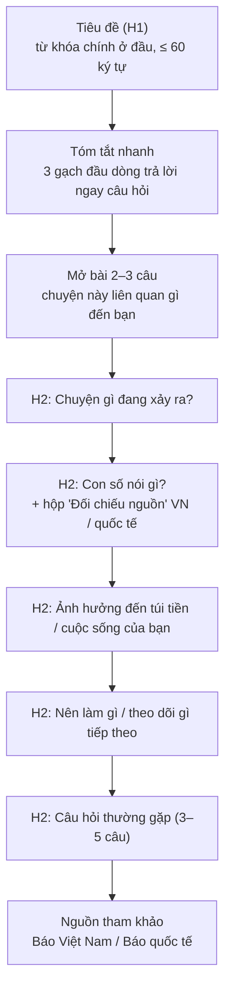

# Khung SEO cho bài viết Tyertrovert — bản nháp v1

> Mục tiêu đã chốt: **tăng lượt đọc và tăng độ nhận biết**.
> Ngân sách công cụ: 200–500k/tháng. Tần suất: 2–3 bài/tuần.
> Khung này dùng cho Agent Soạn thảo (khi viết) và Agent Tổng biên tập (khi chấm).

---

## 1. Chiến lược: trộn 2 loại bài

Chỉ viết tin nóng thì lượt đọc lên nhanh nhưng tụt cũng nhanh. Bài giải thích (evergreen) lên chậm hơn nhưng Google gửi người đọc tới đều đặn trong nhiều tháng. Nên trộn cả hai.

| | Bài **tin nóng** | Bài **giải thích** (evergreen) |
|---|---|---|
| Ví dụ | "Giá xăng giảm 3 kỳ liên tiếp: vì sao và còn giảm tiếp không?" | "Giá xăng ở Việt Nam được tính như thế nào?" |
| Từ khóa | Đang tăng mạnh trên Google Trends | Lượng tìm ổn định quanh năm |
| Thời gian sống | 3–10 ngày | 6–24 tháng |
| Tốc độ đăng | Càng sớm càng tốt (trong 24–48h) | Không gấp |
| Độ dài | 700–1.000 chữ | 1.200–2.000 chữ |
| Tỷ lệ mỗi tuần | **1 bài** | **1–2 bài** |

**Mẹo nối hai loại bài:** mỗi bài tin nóng dẫn link sang một bài giải thích liên quan. Người đọc vào vì tin nóng sẽ ở lại đọc thêm, và bài giải thích được nhiều link trỏ tới nên lên hạng Google dễ hơn.

---

## 2. Chọn từ khóa (Agent Nghiên cứu làm)

Mỗi bài có **1 từ khóa chính** và **3–5 từ khóa phụ**.

| Nguồn | Lấy gì | Chi phí |
|---|---|---|
| Google Trends (khu vực Việt Nam) | Chủ đề nào đang lên, "truy vấn liên quan" | 0đ |
| Google gợi ý khi gõ + mục "Mọi người cũng hỏi" | Câu hỏi thật của người dùng → dùng làm tiêu đề H2 và phần FAQ | 0đ |
| Google Keyword Planner (cần tài khoản Google Ads, không cần chạy quảng cáo) | Lượt tìm theo khoảng, ví dụ 1.000–10.000/tháng | 0đ |
| Google Search Console của blog | Người ta đang tìm từ gì mà ra blog mình | 0đ |
| Keywords Everywhere hoặc công cụ tương tự (tùy chọn) | Số lượt tìm cụ thể ngay trên trang Google | Gói rẻ, mua theo lượt (xem giá lúc mua) |

**Quy tắc chọn từ khóa chính:**
- Viết đúng như người dân gõ, ví dụ "giá xăng hôm nay" chứ không phải "diễn biến giá nhiên liệu".
- Ưu tiên cụm 3–6 chữ có nghĩa rõ ràng ("vay mua xe trả góp lãi bao nhiêu"). Blog mới khó cạnh tranh với các báo lớn ở từ ngắn như "giá vàng".
- Có dạng câu hỏi thì càng tốt ("có nên…", "vì sao…", "bao nhiêu…").

---

## 3. Khung bài viết

### 3.1 Tiêu đề (title)
- **≤ 60 ký tự** (dài hơn sẽ bị Google cắt).
- Từ khóa chính nằm **trong 5–6 chữ đầu**.
- Có thêm một trong các yếu tố: con số, thời điểm ("tháng 11/2026"), câu hỏi, hoặc lợi ích.
- Không giật tít sai sự thật, vì người đọc mất lòng tin thì thương hiệu bị ảnh hưởng.
- Ví dụ: ✅ `Giá xăng giảm 3 kỳ liên tiếp: còn giảm tiếp không?` — ❌ `Bất ngờ với diễn biến mới nhất của thị trường xăng dầu`

### 3.2 Mô tả (description)
- **140–160 ký tự**, có từ khóa chính, nói rõ người đọc nhận được gì.
- Ví dụ: `Giá xăng giảm 3 kỳ liên tiếp nhờ giá dầu thế giới hạ. Mỗi lần đổ đầy bình xe máy rẻ hơn bao nhiêu và tháng 12 giá có giảm tiếp?`

### 3.3 Đường dẫn (slug = tên file)
- Không dấu, ngắn, chứa từ khóa chính, nối bằng gạch ngang, **không dấu cách**.
- ✅ `gia-xang-giam-thang-11.md` — ❌ `diem-nps-giam-khong-ro-ly-do - tập 1.md` (file hiện có trong blog đang chứa dấu cách và chữ có dấu, nên đổi tên).

### 3.4 Hộp "Tóm tắt nhanh" (ngay dưới tiêu đề)
- 3 gạch đầu dòng, mỗi dòng một câu, trả lời luôn câu hỏi chính.
- Lý do: Google và các công cụ AI tìm kiếm (Google AI Overviews, ChatGPT, Perplexity…) hay lấy đoạn trả lời ngắn, rõ ràng như thế này để trích dẫn. Được trích dẫn = tăng nhận biết.

### 3.5 Các mục H2
- Đặt H2 theo **câu hỏi người dùng thật sự gõ** (lấy từ "Mọi người cũng hỏi").
- Mỗi H2 có câu trả lời ngắn gọn ngay câu đầu tiên, sau đó mới giải thích.
- Từ khóa phụ rải tự nhiên vào các H2. Không nhồi từ khóa.

### 3.6 Hộp "Đối chiếu nguồn" — điểm khác biệt của Tyertrovert
Đây là thứ báo khác không có, nên biến nó thành **dấu hiệu nhận biết** của blog:

> **🔍 Đối chiếu nguồn**
> | Thông tin | Báo Việt Nam | Báo quốc tế | Kết quả |
> |---|---|---|---|
> | Giá dầu Brent giảm 8% trong tháng 10 | VnExpress | Reuters | ✅ Khớp |
> | Dự báo tháng 12 giảm tiếp | CafeF | Chưa có | 🔶 Chỉ nguồn VN |

Có hộp này ở mọi bài sẽ giúp người đọc nhớ đến Tyertrovert là "blog đọc tin đã kiểm chứng, viết dễ hiểu". Đó chính là độ nhận biết bạn muốn.

### 3.7 Câu hỏi thường gặp (FAQ)
- 3–5 câu hỏi lấy từ "Mọi người cũng hỏi", mỗi câu trả lời 2–3 câu.
- Giúp bài xuất hiện ở nhiều truy vấn dạng câu hỏi khác nhau.

### 3.8 Liên kết
- **Link nội bộ:** 2–3 link tới bài cũ của blog có liên quan.
- **Link ra ngoài:** mọi con số đều có link tới nguồn.

### 3.9 Ảnh
- Ảnh bìa 1200 × 630 (hiện khi chia sẻ link lên Facebook, Zalo).
- Mọi ảnh có **alt text** mô tả nội dung, chứa từ khóa nếu tự nhiên.
- Định dạng WebP, nén dưới 200KB để trang tải nhanh trên điện thoại.

---

## 4. Checklist SEO cho Tổng biên tập

| # | Kiểm tra | Đạt khi |
|---|---|---|
| 1 | Tiêu đề | ≤ 60 ký tự, có từ khóa chính ở đầu |
| 2 | Mô tả | 140–160 ký tự, có từ khóa chính |
| 3 | Slug | Không dấu, không dấu cách, có từ khóa |
| 4 | Tóm tắt nhanh | Có, đúng 3 dòng |
| 5 | H2 | ≥ 3 mục, ít nhất 1 mục chứa từ khóa phụ |
| 6 | Hộp đối chiếu nguồn | Có, khớp với bảng kiểm chứng trong hồ sơ |
| 7 | FAQ | 3–5 câu |
| 8 | Link | ≥ 2 link nội bộ, mọi con số có link nguồn |
| 9 | Ảnh | Ảnh bìa đúng kích thước, mọi ảnh có alt text |
| 10 | Độ dài | Tin nóng 700–1.000 chữ, bài giải thích 1.200–2.000 chữ |

---

## 5. Phần kỹ thuật blog cần bổ sung (làm 1 lần)

Mình đã xem code blog hiện tại. Phần cơ bản đã ổn: có sitemap, có thẻ canonical, có Open Graph, và có mã xác minh Google Search Console trong `Base.astro`. Còn thiếu:

| Hạng mục | Tác dụng | Mức ưu tiên |
|---|---|---|
| Ảnh chia sẻ (`og:image`) cho từng bài | Link chia sẻ lên Facebook/Zalo có ảnh lớn, được bấm nhiều hơn hẳn | Cao |
| Dữ liệu cấu trúc (JSON-LD `Article`) | Google hiểu rõ đây là bài viết: ngày đăng, tác giả, ảnh | Cao |
| Thẻ cho phép Google Discover hiện ảnh lớn (`max-image-preview:large`) | Google Discover (mục tin trên app Google của điện thoại) là nguồn lượt đọc rất lớn ở VN | Cao |
| Trường `updatedDate` (ngày cập nhật) | Bài giải thích được cập nhật thường xuyên sẽ giữ hạng tốt hơn | Trung bình |
| Trường `tags` và `author` | Gom bài cùng chủ đề, tăng độ tin cậy | Trung bình |
| Gắn domain `tyertrovert.site` | Domain riêng dễ nhớ hơn `...workers.dev`, tốt cho thương hiệu | Cao |

---

## 6. Phân bổ ngân sách 200–500k/tháng

**Đề xuất: 2 tháng đầu dùng 0đ**, chỉ chi khi thấy thật sự thiếu:

| Hạng mục | Công cụ | Chi phí |
|---|---|---|
| Từ khóa | Google Trends + Keyword Planner + Search Console | 0đ |
| Đo lượt đọc | Cloudflare Web Analytics (đã có Cloudflare) | 0đ |
| Biểu đồ | Agent tự vẽ từ số liệu | 0đ |
| Ảnh bìa / ảnh post | Canva bản miễn phí hoặc công cụ tạo ảnh AI bản miễn phí | 0đ |
| **Nếu cần nâng cấp** | Công cụ số lượt tìm (tính theo lượt) + Canva Pro hoặc ảnh AI trả phí | Trong khoảng 200–500k |

> Giá các công cụ trả phí thay đổi thường xuyên. Khi nào cần mua, mình sẽ kiểm tra giá thực tế lúc đó rồi đề xuất cụ thể.

---

## 7. Đo hiệu quả (mỗi tháng)

| Chỉ số | Nguồn | Ý nghĩa |
|---|---|---|
| Lượt xem, số người đọc | Cloudflare Web Analytics | Lượt đọc |
| Số lần hiển thị trên Google | Search Console | Độ nhận biết (bao nhiêu lần tên blog xuất hiện trước mắt người dùng) |
| Số lượt bấm, tỷ lệ bấm (CTR) | Search Console | Tiêu đề và mô tả có hấp dẫn không |
| Từ khóa mang người đọc tới | Search Console | Gợi ý chủ đề cho bài tiếp theo |
| Lượt tìm "Tyertrovert" | Search Console | Có người nhớ tên blog và tìm trực tiếp, thước đo nhận biết rõ nhất |
